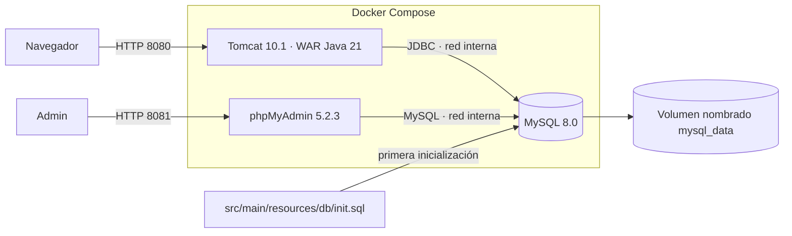
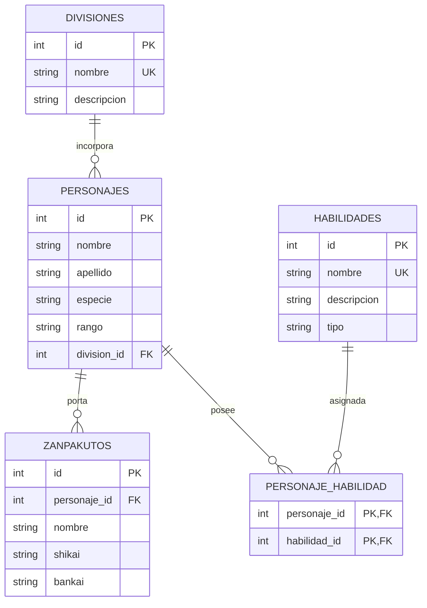

# BleachSoulSociety

Enciclopedia interactiva del universo Bleach para un proyecto académico de Acceso a Datos de 2.º DAM. Incluye una API JSON desacoplada, una interfaz web y una base MySQL con datos iniciales.

## Tecnologías

- Java 21, Maven 3.9.9 y empaquetado WAR.
- Servlets Jakarta 6.0 en Tomcat 10.1.
- JDBC, MySQL 8.0, HikariCP y Gson.
- HTML5, CSS3 y JavaScript moderno con `fetch`.
- Docker multi-stage y Docker Compose; phpMyAdmin 5.2.3.
- JUnit 5, Mockito y H2 para pruebas unitarias e integración JDBC aislada.

## Arquitectura

La aplicación separa las responsabilidades por capas: los servlets gestionan HTTP y JSON, los servicios validan reglas, y los DAO ejecutan SQL parametrizado con JDBC.



`app` y `phpmyadmin` participan en la red privada `bleach-internal` y en una red de entrada para poder publicar sus puertos al host. `db` solo participa en `bleach-internal`, no publica el puerto MySQL al host y tiene healthcheck; `app` espera a que la base esté saludable. Los datos se guardan en el volumen nombrado `mysql_data`.

### Diagrama entidad-relación



`division_id` es opcional. Una división puede contener varios personajes y un personaje puede portar varias zanpakutos. La tabla `personaje_habilidad`, con clave primaria compuesta, representa la relación N:M entre personajes y habilidades.

## Estructura del proyecto

```text
.
├── Dockerfile
├── docker-compose.yml
├── .dockerignore
├── .env.example
├── pom.xml
├── src/main/java/com/bleachsoulsociety/
│   ├── config/       # HikariCP y composición de dependencias
│   ├── controller/   # Servlets y respuestas HTTP/JSON
│   ├── dao/          # Interfaces y DAO JDBC
│   ├── dto/          # Datos de entrada y salida
│   ├── exception/    # Errores de validación, datos y 404
│   ├── model/        # Entidades
│   └── service/      # Reglas y validaciones
├── src/main/resources/db/init.sql
├── src/main/webapp/
│   ├── index.html
│   └── assets/
│       ├── css/ y js/
│       └── images/{portada,personajes,divisiones,zanpakutos,habilidades}/
└── src/test/java/com/bleachsoulsociety/
    ├── dao/          # Integración JDBC con H2 en memoria
    └── service/      # Pruebas unitarias con Mockito
```

## Configuración y credenciales de desarrollo

1. Copia la plantilla en la raíz del repositorio:

   ```powershell
   Copy-Item .env.example .env
   ```

2. Edita `.env` si necesitas cambiar el nombre de la base, los usuarios, las contraseñas o los puertos. El archivo `.env` está excluido por `.gitignore` y `.dockerignore`; no lo añadas al repositorio.

| Variable | Valor de desarrollo en `.env.example` | Uso |
| --- | --- | --- |
| `DB_NAME` | `bleach_soul_society` | Base seleccionada por MySQL y la aplicación |
| `DB_USER` | `bleach_app` | Usuario de la aplicación/phpMyAdmin |
| `DB_PASSWORD` | `bleach_dev_password` | Contraseña de desarrollo de `DB_USER` |
| `MYSQL_ROOT_PASSWORD` | `bleach_root_dev_password` | Contraseña de administración de MySQL |
| `DB_POOL_SIZE` | `10` | Tamaño máximo del pool HikariCP |
| `DB_URL` | URL local de MySQL | Referencia para ejecutar Tomcat fuera de Compose; Compose la sobrescribe con el host `db` |
| `APP_PORT` | `8080` | Puerto HTTP publicado para la aplicación |
| `PHPMYADMIN_PORT` | `8081` | Puerto HTTP publicado para phpMyAdmin |

Las credenciales de la plantilla son solo para desarrollo local: cámbialas antes de cualquier uso compartido o despliegue público. Java no contiene URLs ni credenciales de conexión. El puerto `3306` no se publica al host. JDBC usa explícitamente UTF-8 y `utf8mb4_0900_ai_ci`.

## Instalación y despliegue con Docker

Requisitos: Docker Desktop (o Docker Engine) con Docker Compose v2 y acceso para descargar las imágenes. No se necesita instalar Java o Maven en el equipo: Maven y JDK 21 se usan dentro de la etapa de compilación.

```powershell
Copy-Item .env.example .env
docker compose up --build -d
docker compose ps
```

El primer arranque compila y prueba el WAR en una imagen Maven/Java 21, lo copia a Tomcat 10.1 y crea MySQL, phpMyAdmin, la red y el volumen. MySQL crea el esquema indicado por `DB_NAME`, ejecuta `src/main/resources/db/init.sql` una sola vez y pasa a saludable antes de que arranquen `app` y `phpmyadmin`.

Abre:

- Aplicación: <http://localhost:8080/BleachSoulSociety/>
- phpMyAdmin: <http://localhost:8081/>

En phpMyAdmin inicia sesión con `bleach_app` / `bleach_dev_password`, o con `root` / `bleach_root_dev_password` para administración local. Selecciona la base indicada por `DB_NAME`.

Para revisar el estado y los registros:

```powershell
docker compose ps
docker compose logs -f app db phpmyadmin
```

Para detener y volver a iniciar sin eliminar datos:

```powershell
docker compose stop
docker compose start
```

Los datos permanecen en el volumen `mysql_data`. No uses `docker compose down -v` si quieres conservarlos. El script de inicialización no vuelve a ejecutarse sobre una base que ya tiene datos; para una base nueva se crea otro volumen, pero no borres volúmenes con datos que quieras conservar.

### Codificación UTF-8 y reparación de una base existente

MySQL, las tablas y las conexiones JDBC se configuran con `utf8mb4`; la API responde JSON con `charset=UTF-8`. `init.sql` aplica estos valores al crear una base nueva. Si una base persistente contiene texto dañado por una conversión anterior, ejecuta `src/main/resources/db/utf8mb4_migration.sql` una vez seleccionando `DB_NAME` (por ejemplo, impórtalo en phpMyAdmin con el usuario `root`). La migración convierte las tablas y solo reinterpreta cadenas que coinciden con los bytes de mojibake; no borra tablas ni registros y es idempotente. No borres el volumen para aplicar esta reparación.

### Ejecución manual sin Docker

Se necesita JDK 21, Maven y MySQL instalados por separado. Crea y selecciona la base antes de ejecutar el script:

```sql
CREATE DATABASE bleach_soul_society CHARACTER SET utf8mb4 COLLATE utf8mb4_0900_ai_ci;
USE bleach_soul_society;
SOURCE src/main/resources/db/init.sql;
```

Configura `DB_URL`, `DB_USER`, `DB_PASSWORD` y opcionalmente `DB_POOL_SIZE` en el entorno del proceso Tomcat, compila con `mvn clean package` y despliega `target/BleachSoulSociety.war` en Tomcat 10.1. La aplicación Java no carga `.env` por sí misma.

## Pruebas

```powershell
mvn clean verify
```

Ese comando necesita JDK 21 y Maven instalados. También se ejecuta durante `docker compose up --build -d`, en la etapa Maven del `Dockerfile`. Las pruebas cubren:

- CRUD y filtros de los cuatro DAO, claves duplicadas, claves foráneas, IDs inexistentes y casos opcionales.
- Asignación y retirada de habilidades, incluida la asignación repetida y la comprobación de registros relacionados.
- Validaciones y conversión a DTO en los servicios mediante Mockito.
- Una base H2 aislada y nueva para cada prueba JDBC; no se usa ni se borra la base MySQL de la aplicación.

Última verificación en el contenedor: `mvn clean verify` completó con **16 pruebas, 0 fallos, 0 errores y 0 omitidas**.

## API

Todas las rutas llevan el prefijo `/BleachSoulSociety/api` en Tomcat y reciben/devuelven JSON. Las respuestas de error tienen la propiedad `error`.

| Recurso | Operaciones | Filtros de lista |
| --- | --- | --- |
| `/personajes` | `GET`, `POST`; `GET /{id}`, `PUT /{id}`, `DELETE /{id}` | `nombre`, `divisionId` |
| `/divisiones` | `GET`, `POST`; `GET /{id}`, `PUT /{id}`, `DELETE /{id}` | `nombre` |
| `/zanpakutos` | `GET`, `POST`; `GET /{id}`, `PUT /{id}`, `DELETE /{id}` | `nombre`, `personajeId` |
| `/habilidades` | `GET`, `POST`; `GET /{id}`, `PUT /{id}`, `DELETE /{id}` | `nombre`, `tipo` |
| `/personajes/{id}/habilidades` | `GET`, `POST` (cuerpo `{ "habilidadId": 1 }`) | — |
| `/personajes/{id}/habilidades/{habilidadId}` | `DELETE` | — |

Las creaciones y asignaciones responden `201`; consultas, actualizaciones y eliminaciones responden `200`. Las validaciones y conflictos de integridad responden `400`, los recursos inexistentes `404` y los errores internos `500`. Los DTO de escritura usan: personaje (`nombre`, `apellido`, `especie`, `rango`, `divisionId`), división (`nombre`, `descripcion`), zanpakuto (`personajeId`, `nombre`, `shikai`, `bankai`) y habilidad (`nombre`, `descripcion`, `tipo`).

## Manual de uso de la interfaz

1. Abre la aplicación y usa el menú para entrar en Inicio, Personajes, Divisiones del Gotei 13, Zanpakutos o Habilidades.
2. En las listas puedes buscar y aplicar los filtros disponibles; en Personajes también puedes filtrar por raza y división.
3. Usa **Añadir** para crear registros. Las listas de portadores y divisiones se cargan desde la API; los formularios validan campos obligatorios y longitudes.
4. Abre **Detalles** para consultar una ficha; en personajes puedes asignar o retirar habilidades.
5. Edita con el botón de lápiz o elimina con el botón ×; la interfaz pide confirmación antes de borrar.
6. La página muestra indicadores de conexión, carga y errores/confirmaciones. Todos los cambios se guardan en MySQL mediante los endpoints reales.

### Imágenes locales y permisos de redistribución

- Las 16 fotografías de personajes y `portada/portada.jpg` fueron añadidas manualmente. No se proporcionó ni verificó su procedencia, autoría, licencia o autorización explícita de redistribución.
- En consecuencia, **ninguna de las 17 imágenes se incluye en Git ni en el ZIP de entrega**. Los archivos originales se mantienen intactos en el ordenador donde se añadieron; quedan pendientes de autorización documentada.
- Los marcadores SVG y `portada/panorama.svg` permanecen en el proyecto. El inventario con los nombres, asociaciones y estado de permisos está en `src/main/webapp/assets/images/README.md`.